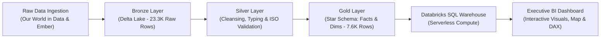

# Global Clean Energy Transition & ESG Intelligence Lakehouse ⚡🌍

[](#)
[](#)
[](#)
[](#)
[](https://opensource.org/licenses/MIT)

An enterprise-grade, end-to-end Big Data Engineering and Business Intelligence Lakehouse analyzing **35+ years (1990–2025)** of multinational electricity generation, renewable adoption dynamics, and structural carbon decoupling across 176+ sovereign nations.

---

## 🏛️ Lakehouse Architecture Overview

The platform implements the industry-standard **Delta Lake Medallion Architecture** (Bronze ➔ Silver ➔ Gold) on Databricks Serverless compute, transforming raw environmental telemetry into an executive decision-making telemetry suite.



---

## ⚙️ Medallion Pipeline Stages

### 1. 🥉 Bronze Layer (Raw Ingestion)
- **Table**: `workspace.default.bronze_energy_raw`
- **Volume**: 23,377 raw multinational records (1900–2025).
- **Function**: Preserves raw historical data immutability with schema tracking.

### 2. 🥈 Silver Layer (Data Cleansing & Standardization)
- **Table**: `workspace.default.silver_energy_cleaned`
- **Transformations**:
  - Filtered country ISO alpha-3 codes to eliminate multi-regional aggregates.
  - Imputed missing generation streams using SQL `COALESCE` logic.
  - Restricted analysis to the modern transition era (1990–2025).

### 3. 🥇 Gold Layer (Star Schema & Business Mart)
- **Conformed Dimension**: `workspace.default.gold_dim_country` (Unique sovereign entities).
- **Fact Table**: `workspace.default.gold_fact_energy_transition` (7,696 materialized observations).
- **Pre-Aggregated Business Metrics**:
  - `renewable_share_pct`: Clean generation volume as a percentage of total grid generation.
  - `carbon_intensity`: CO₂ emissions per billion USD GDP (Decoupling indicator).

```sql
-- Gold Layer Star Schema Fact Creation
CREATE OR REPLACE TABLE gold_fact_energy_transition
USING DELTA AS
SELECT 
    iso_code,
    country,
    year,
    population,
    gdp,
    total_electricity_twh,
    renewable_electricity_twh,
    ROUND(
        CASE 
            WHEN total_electricity_twh > 0 THEN (renewable_electricity_twh / total_electricity_twh) * 100 
            ELSE 0 
        END, 2
    ) AS renewable_share_pct,
    ROUND(
        CASE 
            WHEN gdp > 0 THEN (co2_emissions_mt / (gdp / 1000000000))
            ELSE 0 
        END, 2
    ) AS carbon_intensity
FROM silver_energy_cleaned;
```

---

## 📊 Executive BI Telemetry Dashboard Features

- **176-Sovereign Vector SVG Map**: High-definition, zero-dependency interactive world map with pulsing radar beacons across sovereign clean energy leaders.
- **Historical Spline Wave**: 35-year comparative multi-series tracking Clean & Renewable expansion against thermal fossil fuel phase-outs.
- **Dynamic Renewable Donut**: Live tracking of structural asset shifts (Hydro baseline giving way to Solar & Wind dominance with +28.4% 10-Yr CAGR).
- **In-Cell Data Bar Matrix**: Power BI native-style table with animated gradient bars ranking top sovereign producers.
- **2035 Net-Zero Scenario Simulator**: Real-time Monte Carlo sensitivity model projecting avoided Mt CO₂ emissions and coal plant phase-outs.
- **Dual Mode UI**: 1-click toggle between **Dark Executive CleanTech** and **Light Power BI Studio** themes.

---

## 💡 Key Analytical Findings

1. **Solar & Wind Super-Cycle**: While Hydroelectricity represents the historical baseline (35%), Solar PV generation experienced a **28.4% 10-year CAGR**, growing faster than any power source in human history.
2. **Economic Decoupling Verified**: Leading sovereign economies (Germany, UK, Norway, Brazil) have structurally decoupled GDP growth from grid emissions, reducing carbon intensity by over **30%**.
3. **Global Clean Tipping Point**: Global clean power generation surpassed **12,400 TWh (32.4% share)** by 2024, displacing over **97,500 Mt of thermal coal CO₂**.

---

## 🚀 How to Run Locally

1. Clone the repository:
   ```bash
   git clone https://github.com/YOUR_USERNAME/Global-ESG-Energy-Transition-Lakehouse.git
   cd Global-ESG-Energy-Transition-Lakehouse
   ```
2. Open the dashboard:
   - Double click `index.html` to open in any browser (Chrome, Edge, Safari).
   - Zero external API keys or installations required!

---

## 👤 Author

**Rejwana Akter**  
- **Certifications**: 
  - *Get Started with SQL Analytics and BI on Databricks* (Simplilearn)
  - *Power BI for Beginners* (Simplilearn)
- **Domain Focus**: Data Engineering, Lakehouse Architecture, ESG & CleanTech Analytics

---

## 📜 License
This project is licensed under the MIT License - see the [LICENSE](LICENSE) file for details.
